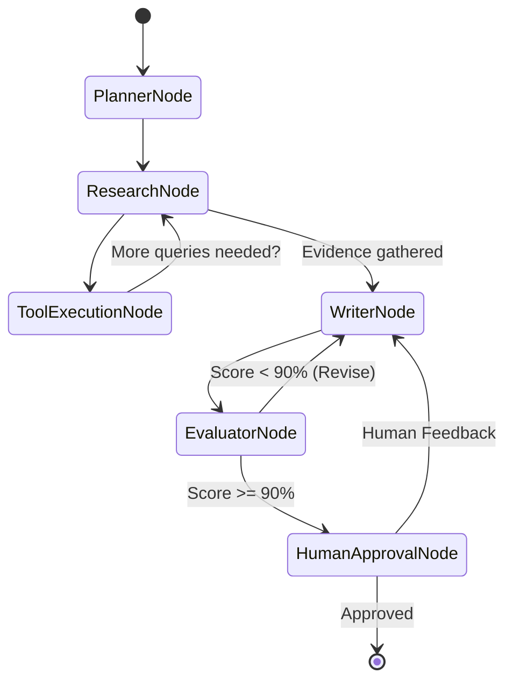

# 🧠 LangGraph: Autonomous Multi-Agent Architectures

## 📖 Theoretical Foundations & Curriculum
This module documents my hands-on mastery of **LangGraph**, the framework for building stateful, controllable multi-agent applications.

### 🌟 Key Design Patterns
1. **StateGraph & Cyclic Transitions:** Unlike linear DAG frameworks, LangGraph allows cycles where agents can iteratively query tools, self-critique drafts, and refine outputs until passing rigorous quality thresholds.
2. **State Checkpointing (`MemorySaver`):** Every state change is serialized into a snapshot identified by a `thread_id`, enabling state rollback, multi-turn conversational isolation, and session resumption.
3. **Human-in-the-Loop (HITL):** Breakpoints defined before critical tool nodes (e.g. database mutations, payment processing, final publication) pause graph execution to await human approval or corrective input.
4. **Hierarchical Multi-Agent Teams:** Coordination between specialized roles:
   - `PlannerAgent`: Converts vague goals into ordered, atomic dependencies.
   - `ResearchAgent`: Executes web searches (Tavily) and queries vector databases.
   - `WriterAgent`: Compiles citations and draft text.
   - `EditorAgent`: Evaluates draft against rubrics (Accuracy, Completeness, Grounding).

---

## 🏗️ State Transition Architecture

---

## 💻 Code Artifacts
- [`agent_workflow.py`](./agent_workflow.py): Production implementation of a cyclic LangGraph state machine with checkpointer and human-in-the-loop interruption.
- [`essay_writer_agent.py`](./essay_writer_agent.py): Multi-agent essay writing pipeline featuring iterative critique loops.
- [`demo_langgraph.py`](./demo_langgraph.py): Interactive CLI runner.
