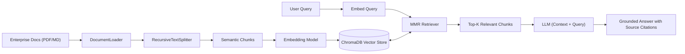

# 📚 LangChain: Chat with Your Data (Production RAG)

## 📖 Theoretical Foundations & Curriculum
This module covers the end-to-end design and optimization of **Retrieval-Augmented Generation (RAG)** systems for grounding LLM generation in private or domain-specific unstructured corpora.

### 🌟 Key Pipeline Stages
1. **Document Ingestion (Loaders):** Parsing heterogeneous enterprise file types (PDF, Markdown, HTML, CSV, DOCX) while retaining document metadata (source path, page numbers, author).
2. **Semantic Text Chunking:** Utilizing `RecursiveCharacterTextSplitter` with hierarchical separators `["\n\n", "\n", " ", ""]` to ensure chunks never split paragraphs or sentences awkwardly.
3. **Vector Embeddings & Indexing:** Generating high-dimensional vector representations and persisting them within ChromaDB with HNSW index acceleration.
4. **Advanced Retrieval Strategies:**
   - **Similarity Search:** Dense cosine similarity lookup.
   - **Maximal Marginal Relevance (MMR):** Balances relevance to query with diversity among retrieved chunks, avoiding redundant context.
   - **Contextual Compression & Filtering:** Pruning irrelevant sentences before injecting retrieved chunks into the prompt context window.

---

## 🏗️ RAG Architecture Pipeline

---

## 💻 Code Artifacts
- [`rag_pipeline.py`](./rag_pipeline.py): Production implementation of document chunking, ChromaDB vector indexing, and MMR retrieval.
- [`demo_rag_chat.py`](./demo_rag_chat.py): Interactive CLI chat interface over local documents.
