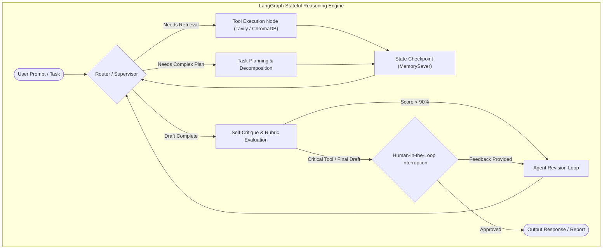

# 🚀 Advanced AI Engineering & Autonomous Agents Interactive Portfolio

[](https://eng-ahmed-rifai.github.io/AI-Engineering-Interactive-Portfolio/)
[](https://share.streamlit.io/)
[](https://www.deeplearning.ai/)
[](https://www.langchain.com/)
[](https://langchain-ai.github.io/langgraph/)
[](https://huggingface.co/)
[](https://opensource.org/licenses/MIT)

> **Architect & Engineer:** [Ahmed Mohamed Abdullatif Rifai](https://github.com/Eng-Ahmed-Rifai)  
> **Credential Authority:** DeepLearning.AI & Coursera (Completed at 100.00% Grade)  
> **Repository Purpose:** Production-grade laboratory implementations, interactive web simulators, and autonomous multi-agent pipelines covering stateful graph reasoning, Retrieval-Augmented Generation (RAG), dynamic memory chaining, and open-source foundation model inference.

---

## 🌐 Live Interactive Demos

Experience the architectures live without installing dependencies:

| Interactive Platform | Access URL | Features Demonstrated |
| :--- | :--- | :--- |
| **Zero-Setup Web Simulator (GitHub Pages)** | [Launch Web Simulator](https://eng-ahmed-rifai.github.io/AI-Engineering-Interactive-Portfolio/) | Visual LangGraph node stepper, interactive RAG chunker & cosine similarity visualizer, memory buffer comparison, Hugging Face task runner. |
| **Streamlit Community Cloud** | Run via `streamlit run streamlit_app.py` | Full Python backend with real LangChain / LangGraph execution, file uploads, vector indexing, and dynamic tool calls. |

---

## 🏛️ System Architecture: LangGraph Cyclic State Machine

Unlike conventional linear DAG pipelines, production agents require **cyclic graphs** with state persistence and human intervention gates:



---

## 📦 Projects Portfolio Breakdown

### 1. 🧠 [AI Agents in LangGraph](./01_LangGraph_Autonomous_Agents/)
- **Core Focus:** Building stateful, controllable multi-agent systems using `langgraph.graph.StateGraph`.
- **Architectural Highlights:**
  - Checkpointed state persistence (`MemorySaver`) enabling conversational thread management and time-travel debugging.
  - Multi-agent collaboration: `Planner`, `Researcher`, `Writer`, and `Editor` with structured JSON messaging.
  - Interrupt points for Human-in-the-Loop approval before external mutations.

### 2. 📚 [LangChain Chat with Your Data (Production RAG)](./02_LangChain_RAG_Chat_With_Data/)
- **Core Focus:** End-to-end Retrieval-Augmented Generation over unstructured enterprise corpora.
- **Architectural Highlights:**
  - Multi-source document loaders (PDF, Markdown, HTML, CSV).
  - Semantic chunking with `RecursiveCharacterTextSplitter` preserving semantic boundary integrity.
  - Vector retrieval with ChromaDB, Maximal Marginal Relevance (MMR) for query diversification, and contextual compression.

### 3. ⛓️ [LangChain for LLM Application Development](./03_LangChain_LLM_App_Development/)
- **Core Focus:** Modular orchestration primitives for reliable LLM pipelines.
- **Architectural Highlights:**
  - Structured output parsing with Pydantic validation.
  - Sequential and conditional router chains routing requests to specialized domain experts.
  - Comparative conversational memory: `ConversationBufferMemory`, `ConversationBufferWindowMemory`, and `ConversationSummaryMemory`.

### 4. 🤗 [Open Source Models with Hugging Face](./04_HuggingFace_OpenSource_Models/)
- **Core Focus:** Production deployment of open-weights models from the Hugging Face Hub.
- **Architectural Highlights:**
  - Multi-modal inference pipelines (LLMs, Whisper speech-to-text, vision transformers).
  - Model quantization (4-bit / 8-bit via BitsAndBytes) for low-latency edge deployment.
  - Micro-app deployment with Gradio and Hugging Face Spaces.

---

## 🚀 Quick Start (Local Setup)

```bash
# Clone the repository
git clone https://github.com/Eng-Ahmed-Rifai/AI-Engineering-Interactive-Portfolio.git
cd AI-Engineering-Interactive-Portfolio

# Create virtual environment & activate
python -m venv .venv
source .venv/bin/activate  # On Windows: .venv\Scripts\activate

# Install dependencies
pip install -r requirements.txt

# Run the interactive Streamlit application
streamlit run streamlit_app.py
```

---

## 📜 Verified Coursera & DeepLearning.AI Credentials

All 4 specialized laboratory curriculums were officially completed by **Ahmed Mohamed Abdullatif Rifai** with **100.00% Grade Perfection**:
- **AI Agents in LangGraph** — DeepLearning.AI (Completed October 21, 2026 | Grade: 100%)
- **LangChain Chat with Your Data** — DeepLearning.AI (Completed October 21, 2026 | Grade: 100%)
- **LangChain for LLM Application Development** — DeepLearning.AI (Completed October 21, 2026 | Grade: 100%)
- **Open Source Models with Hugging Face** — DeepLearning.AI (Completed October 21, 2026 | Grade: 100%)

---

## 📄 License
This repository is licensed under the [MIT License](LICENSE).
